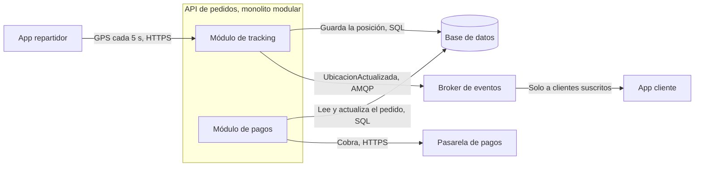

# Escenario de calidad a probar: rastreo GPS en el pico del almuerzo

Caso 3 — Domicilios locales · Grupo 3

## Por qué este escenario

Es el primer atributo del ADR-000 y el Escenario 1 de `vision.md`. Rastrear al repartidor es la promesa
diferencial del producto y la mayor presión sobre la infraestructura: 400 repartidores emitiendo cada
5 s dan ~80 eventos/s durante las 2 horas que concentran el 35 % de los pedidos. Además, es el único
escenario que pone en riesgo a otro flujo: el tracking comparte runtime con el cobro.

| Escenario comparado | Por qué no se eligió |
|---|---|
| Una sola verdad del pedido (`vision.md`, Escenario 2) | Afecta cambios de estado, unos pocos por pedido (~4 pedidos nuevos por minuto en el pico), no un flujo continuo de 80 eventos/s |
| Recuperación tras desconexión (ADR-000, atributo 3) | Afecta a un repartidor a la vez y no pone en riesgo el cobro de los demás pedidos |
| El modelo no responde o propone mal (ADR-002) | Si falla, el cliente sigue teniendo el menú normal: se pierde la función, no el pedido |

## La medida

| Condición | Número | Origen | Ventana |
|---|---|---|---|
| Latencia de retransmisión | p95 ≤ 3 s desde la emisión | ADR-000 y `vision.md`, Escenario 1 | Pico del almuerzo, 120 min |
| Carga sostenida | ≥ 80 eventos/s | 400 repartidores ÷ 5 s | Pico del almuerzo, 120 min |
| Pérdida de eventos | ≤ 5 % | `vision.md`, Escenario 1 | Pico del almuerzo, 120 min |
| Cobro sin degradarse | p95 ≤ 2 s | SLA de pago, `vision.md`, Escenario 1 | Pico del almuerzo, 120 min |

**Ventana de la prueba.** No se ejecutan 120 min: la prueba mide 30 s de carga de pico (configurable con
`DURACION_S`). Si la prueba falla, la conclusión vale para el pico completo, porque una cola saturada
solo sigue creciendo. Si pasa, solo demuestra que no hay saturación en esos 30 s.

## Camino en la vista de contenedores

Se implementa solo este camino. No hacen falta autenticación, catálogo, asignación ni notificador.

Los dos módulos comparten las conexiones de la base de datos. Ese es el punto de presión que declara
`vision.md`: una ráfaga de tracking podría degradar los pagos.
