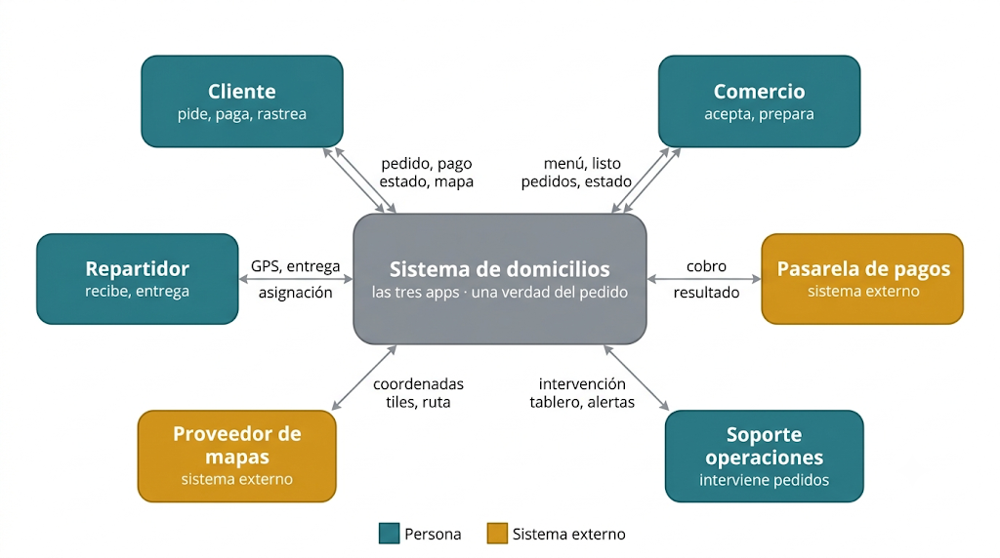

# Visión del sistema — Caso 3: Domicilios locales

## Actores

| Actor | Qué entrega / qué recibe |
|---|---|
| **Cliente** | Entrega: ítems del pedido, dirección, método de pago (token si es en línea), calificación. Recibe: catálogo y menús con disponibilidad y tiempos, estado del pedido, posición del repartidor en el mapa, notificaciones, confirmación de pago. |
| **Comercio** | Entrega: menú y disponibilidad, tiempos de preparación, aceptación/rechazo, transiciones «en preparación» y «listo para recoger». Recibe: pedidos nuevos, datos del repartidor asignado, notificaciones, calificación. |
| **Repartidor** | Entrega: disponibilidad, aceptación/rechazo de la asignación, ubicación GPS cada 5 s, confirmación de recogida y entrega. Recibe: asignaciones (pedido, direcciones comercio→cliente), notificaciones, calificación. |
| **Pasarela de pagos (externo)** | Entrega: resultado de la transacción (aprobada/rechazada), webhook de confirmación de cobro. Recibe: solicitud de cobro (monto, referencia del pedido, token de pago). |
| **Soporte de operaciones** | Entrega: intervenciones (reasignar, cancelar, reembolsar, contactar partes). Recibe: tablero de pedidos activos y alertas de demora/anomalías. |
| **Proveedor de mapas (externo)** | Entrega: tiles del mapa y cálculo de ruta. Recibe: coordenadas a resolver (geocoding, trazado). |

## Funciones esenciales

La esencia del sistema, no la lista completa de requisitos. Si al quitar una función el sistema sigue teniendo sentido, no era esencial.

1. **Publicar catálogo y disponibilidad:** esta función despliega la lista actualizada de comercios afiliados, menús, precios y la disponibilidad de productos en tiempo real para el cliente; es fundamental porque sin esta información el usuario no tiene qué consultar ni cómo iniciar una orden, constituyendo el punto de entrada primario a todo el flujo de la plataforma.
2. **Crear el pedido y cobrarlo:** esta función registra formalmente la solicitud de compra y procesa la transacción de cobro (ya sea mediante pago en línea o registrando la modalidad de pago contra entrega) para el cliente y el comercio; es crucial porque materializa la intención de compra y habilita el resto del flujo.
3. **Gestionar el ciclo de estados del pedido:** esta función controla y actualiza la secuencia de vida de la orden (creado, aceptado, en preparación, en camino, entregado / cancelado) para el cliente, el comercio y el repartidor; es indispensable porque establece la «única verdad» compartida entre los tres actores, evitando inconsistencias operativas o retrasos en la entrega.
4. **Asignar repartidor con reasignación:** esta función selecciona y oferta automáticamente el pedido al repartidor disponible más cercano, reasignándolo a otro usuario si el primero no lo acepta, dirigida al repartidor y al soporte de operaciones; es vital porque actúa como el motor logístico que vincula la orden con la flota, garantizando que el domicilio no se quede estancado en el comercio.
5. **Rastrear al repartidor en vivo:** esta función captura continuamente los eventos de posición GPS enviados por la aplicación móvil del repartidor y los retransmite dinámicamente sobre un mapa interactivo para el cliente; es esencial porque representa la promesa diferencial del producto, reduciendo la incertidumbre y ofreciendo visibilidad en tiempo real durante el trayecto.
6. **Notificar cada cambio de estado a las tres partes:** esta función emite alertas automáticas e instantáneas hacia los dispositivos cada vez que ocurre un evento relevante en la orden, dirigida simultáneamente al cliente, al comercio y al repartidor; es importante porque mantiene sincronizadas las tres pantallas activas en todo momento, permitiendo que cada parte actúe coordinadamente en la fase del pedido que le corresponde.

Quedan fuera por no ser esenciales a la existencia del sistema: la calificación (el sistema entrega comida sin ella) y el tablero de operaciones (mejora la operación pero el pedido fluye sin él en condiciones normales).

## Diagrama de contexto (C4 nivel 1)

El sistema como caja negra; alrededor, actores y sistemas externos; flechas etiquetadas con la información que fluye. Sin tecnologías ni módulos internos.

### Decisión de frontera

La pasarela de pagos queda fuera del sistema. El sistema no procesa ni almacena datos de tarjeta (PAN): delega el cobro a un tercero y solo recibe el resultado. Se saca del límite para no entrar en el alcance regulatorio de PCI-DSS, reducir el riesgo de manejar datos sensibles y poder cambiar de proveedor sin tocar el núcleo. Por la misma lógica queda fuera el proveedor de mapas/geocoding: no generamos cartografía, la consumimos. Dentro del límite vive solo la lógica del dominio de domicilios (pedido, estados, asignación, tracking).

## Escenario de calidad 1: la tensión principal

**«Tiempo real que no arruine» — rendimiento y escalabilidad del flujo GPS**

| Parte | Contenido |
|---|---|
| **Fuente** | Los 400 repartidores activos (sus apps emitiendo GPS). |
| **Estímulo** | Emiten ubicación cada 5 s de forma concurrente → ~80 eventos/s agregados, mientras ~2.000 clientes observan sus mapas en simultáneo. |
| **Artefacto** | El canal de ingestión y distribución de ubicaciones (subsistema de tracking en tiempo real). |
| **Entorno** | Operación normal en el pico del almuerzo, carga máxima sostenida (2 horas). |
| **Respuesta** | El sistema ingiere las ubicaciones, retiene solo la última posición por repartidor (descarta el histórico intermedio) y la retransmite únicamente a los clientes suscritos a ese pedido. |
| **Medida** | El 95 % de las actualizaciones se reflejan en el mapa del cliente en ≤ 3 s desde su emisión, sosteniendo ≥ 80 eventos/s durante los 120 min del pico, con pérdida tolerada ≤ 5 % de eventos intermedios y sin que la latencia p95 del flujo de pago supere su SLA de 2 s. |

## Escenario de calidad 2

**«Una sola verdad del pedido» — consistencia y propagación ordenada de estado**

| Parte | Contenido |
|---|---|
| **Fuente** | El comercio. |
| **Estímulo** | Marca el pedido como «listo para recoger» (un cambio de estado). |
| **Artefacto** | El subsistema de gestión de estados del pedido y su propagación a las tres apps. |
| **Entorno** | Operación normal en el pico, con la app del repartidor en conectividad intermitente. |
| **Respuesta** | El cambio se registra una sola vez, se propaga a las tres apps en el orden causal correcto (nunca «entregado» antes que «en camino») y queda consistente aunque un consumidor estuviera desconectado (al reconectar recibe el estado vigente, no la secuencia perdida). |
| **Medida** | El 99 % de los cambios de estado se reflejan en las tres apps en ≤ 5 s, con 0 inversiones de orden observadas por el cliente, y un repartidor que reconecta tras ≤ 2 min recupera el estado vigente en ≤ 10 s. |

## ¿Monolito o distribuido?

**Decisión: monolito modular (un solo desplegable) para la v1.**

Justificación por las tensiones del caso:

- **Margen delgado por pedido:** la sobrecarga operativa de microservicios (varios servicios, broker, malla, observabilidad distribuida) no se paga a 40.000 pedidos/mes.
- **Equipo pequeño:** las transacciones distribuidas y el debugging entre servicios multiplican el costo de cada cambio.
- **Picos predecibles y acotados:** escalar horizontalmente un monolito en la ventana del almuerzo basta; aún no hace falta escalar cada capacidad por separado.

**Trade-off declarado.**

Se sacrifica la escalabilidad y el despliegue independientes. En el pico hay que escalar todo el proceso aunque solo el tracking y la creación de pedidos lo necesiten, pagando CPU/RAM de más; y cualquier despliegue reempaqueta todo, subiendo el riesgo de cada release. El punto de presión es el flujo GPS (~80 ev/s, efímero) compartiendo runtime con el flujo transaccional (durable): una ráfaga de tracking podría degradar los pagos. Mitigación barata de revertir: fronteras internas de módulo estrictas y fan-out de tracking vía broker, para que extraer el canal de tiempo real sea barato cuando el pico lo exija.

## Lo síncrono y lo asíncrono del caso

### Síncrona: confirmación del cambio de estado al marcar «listo para recoger»

En la dimensión síncrona del caso, cuando el comercio marca un pedido como «listo para recoger» en su tableta, es el comercio quien necesita la respuesta en ese instante mediante una interacción síncrona (Request/Response), requiriendo la confirmación inmediata del servidor de que el cambio de estado fue registrado exitosamente. Si el servidor o la red del comercio están caídos en ese momento, el sistema efectúa un fallo rápido (timeout corto) notificando «Error de comunicación: estado no actualizado» en la pantalla de la tableta, lo que impide que el restaurante asuma erróneamente que la actualización se procesó o que el repartidor ya viene en camino.

### Asíncrona: notificación y propagación de cambios de estado a las otras apps

La dimensión asíncrona aplica para el repartidor y el cliente, quienes únicamente necesitan enterarse del evento. El servidor deposita la notificación en una cola de mensajes (Broker/Pub-Sub) y le responde inmediatamente al comercio, sin quedarse bloqueado esperando la confirmación de recepción de las otras dos aplicaciones. Dado que la flota de repartidores opera con datos móviles precarios e intermitentes, si la aplicación del repartidor se encuentra sin señal, el mensaje permanece resguardado en la cola y se entrega en cuanto el dispositivo recupera conectividad, sincronizando su pantalla sin haber congelado en ningún momento la operación del comercio. Para evitar el crecimiento desmedido de la cola ante caídas prolongadas de red, esta se acota mediante tiempo de vida (TTL) y políticas de dead-letter, garantizando que al reconectarse el repartidor reciba siempre el estado más reciente.

## Contribuciones del cuestionario

| Parte del cuestionario | Integrante |
|---|---|
| P1-P2 · Actores y funciones esenciales | Jesús David Barrera Montes |
| P3 · Diagrama de contexto y frontera | Jesús David Barrera Montes |
| P4 · Primer escenario de calidad | Jesús David Barrera Montes |
| P5 · Segundo escenario de calidad | Deisler Said Prado Ospina |
| P6–P7 · Monolito/distribuido y sync/async | Deisler Said Prado Ospina |
| P8 · ADR-000 y consolidación | Deisler Said Prado Ospina |